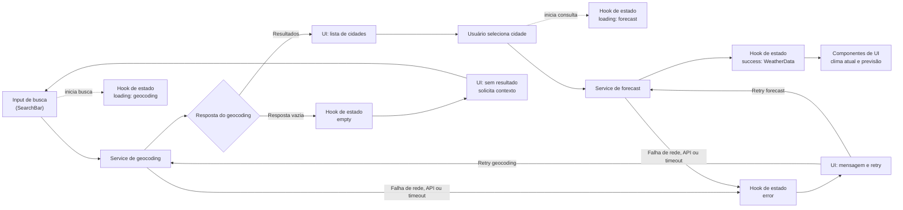

# Resumo Executivo

- O produto permitirá buscar cidades, consultar o clima atual e a previsão de hoje mais os quatro dias seguintes, alternando entre Celsius e Fahrenheit.
- A interface será em pt-BR, usará dados do Open-Meteo e não exigirá autenticação nem armazenamento no servidor.
- As personas propostas representam deslocamentos diários, planejamento de atividades ao ar livre e viagens, mas ainda precisam ser validadas com usuários.
- Os principais riscos são dados indisponíveis ou desatualizados, busca ambígua e experiência inadequada em dispositivos móveis.
- Ainda é necessário definir público prioritário, cobertura e atualização dos dados, conteúdo da previsão, metas de qualidade e critérios de sucesso.

## Fluxo de Dados

